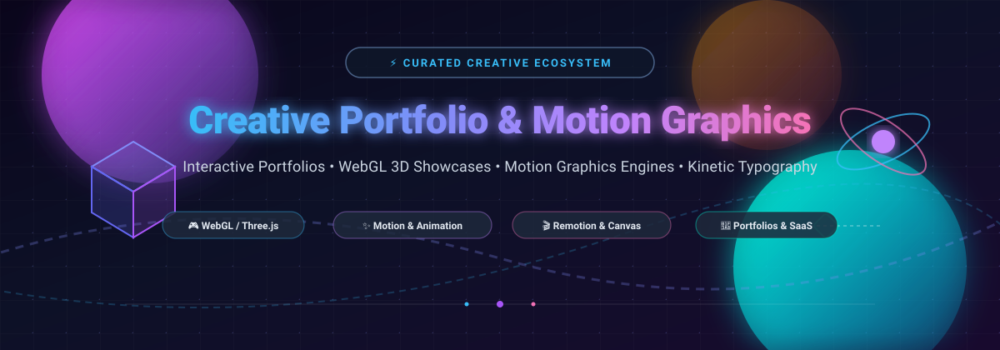

# 🎨 Awesome Creative Portfolio & Motion Graphics 🎬✨

### *A Curated Directory of Next-Gen Creative Showcases, Interactive Designer Portfolios, 3D WebGL Experiences, and Motion Design Engines* 🚀

  
  
  
  
  
  

  <b>Explore leading SaaS portfolio builders, GPU-accelerated WebGL engines, programmatic video frameworks, and cutting-edge animation tools for creative developers, motion designers, and 3D visual artists.</b>

📅 **Last updated:** November 2026 • 🌟 **Curated by:** [@ishandutta2007](https://github.com/ishandutta2007)

---

## 📑 Table of Contents

- [🌐 Sector Overview & Market Dynamics](#-sector-overview--market-dynamics)
- [💼 SaaS & Hosted Portfolio Platforms](#-saas--hosted-portfolio-platforms)
- [🛠️ Open-Source GitHub Projects (Ranked by Stars)](#️-open-source-github-projects-ranked-by-stars)
  - [⭐ Tier 1: 50,000+ Stars](#-tier-1-50000-stars)
  - [🌟 Tier 2: 20,000 – 50,000 Stars](#-tier-2-20000--50000-stars)
  - [✨ Tier 3: 10,000 – 20,000 Stars](#-tier-3-10000--20000-stars)
  - [🚀 Tier 4: Emerging & Focused Tools (< 10,000 Stars)](#-tier-4-emerging--focused-tools--10000-stars)
- [🏗️ Recommended Architecture Stacks](#️-recommended-architecture-stacks)
- [🤝 How to Contribute](#-how-to-contribute)
- [💖 Support & Sponsorship](#-support--sponsorship)
- [📈 Star History](#-star-history)
- [⚠️ Disclaimer](#️-disclaimer)

---

## 🌐 Sector Overview & Market Dynamics

The global website builder and creative showcase software market is estimated at approximately **$3.5B to $5.3B** (scaling past **$13B** when broader CMS, creator economy platforms, and digital asset management ecosystems are included), expanding at a ~10–12% CAGR fueled by AI-assisted layout generators, WebGL/WebGPU 3D rendering in browsers, and interactive kinetic animation. 

The sector displays a **pronounced barbell dynamic that is concentrated at the head and fragmented at the tail**:
1. **Head (Concentrated / Winner-Take-Most):** High-volume general-purpose website building and turnkey hosted portfolios are tightly dominated by multi-billion dollar publicly traded giants and private equity platforms (Adobe, Squarespace, Wix), which command massive distribution, integrated payment rails, and global hosting infrastructure.
2. **Tail (Highly Fragmented & Specialized):** Professional creative developers, avant-garde motion designers, 3D artists, and creative agencies heavily eschew generic cookie-cutter templates. This drives deep fragmentation into specialized boutique SaaS builders (Cargo, Format, Fabrik) and an explosive open-source ecosystem centered around high-performance shader engines, procedural canvas frameworks, and custom React/Three.js animation runtimes.

---

## 💼 SaaS & Hosted Portfolio Platforms

| Platform | Company Scale (Revenue / Valuation) | Pricing (Starting Paid Tier) | Free Tier / Trial Limits | Description |
| :--- | :--- | :--- | :--- | :--- |
| **[Adobe Portfolio](https://adobe.com)** | Parent (Adobe Inc.): **$21.5B+ annual revenue** / **~$146B–$195B market cap** | Included with Adobe Creative Cloud (from **$9.99/mo** Photography Plan) | **No standalone free plan or trial**; bundled with CC plans. Allows publishing up to 5 sites with custom domains and Adobe Fonts, but strictly lacks e-commerce and client proofing. | Hosted portfolio website builder integrated with Adobe Creative Cloud and Behance for rapidly deploying responsive galleries and project pages. |
| **[Behance (Adobe)](https://behance.net)** | Subsidiary of Adobe (Acquired for **~$150M**; Adobe: **$21.5B+ revenue**) | Behance Pro starts at **$9.99/mo** (billed annually) or **$13.99/mo** (monthly) | **Permanent free plan**: Unlimited public projects and media uploads; limited to standard public profile layout, standard analytics, and subject to 2%–5% freelance platform fees (no password-protected/unlisted projects). | Leading global creative showcase network for graphic designers, motion artists, 3D illustrators, and UI/UX teams to publish rich multimedia case studies. |
| **[Squarespace](https://squarespace.com)** | **$1.0B+ annual revenue** / **$7.2B acquisition valuation** (Permira) | Basic plan starts at **$19/mo** (billed annually) or **$25/mo** (monthly) | **14-day free trial** (extendable by 7 days upon request; no credit card required). Trial sites remain private/unpublished with no live e-commerce processing or public search indexing. | All-in-one website building and portfolio hosting platform renowned for editorial templates, high-resolution visual galleries, and built-in e-commerce. |
| **[Wix Studio](https://wix.com)** | **$1.76B+ annual revenue** / **~$6B–$12B market cap** (NASDAQ: WIX) | Studio Basic plan starts at **$19/mo** (billed annually) or **$27/mo** (monthly) | **Permanent free plan on standard Wix** (500MB storage, 500MB bandwidth, Wix ads, non-custom subdomain); **Wix Studio sites provide unlimited private staging/testing**, requiring a paid plan to remove branding and connect custom domains. | Advanced visual web creation platform offering scroll-driven animations, custom CSS/JS interactions, responsive breakpoints, and client handoff tools for agencies. |
| **[Dribbble](https://dribbble.com)** | Subsidiary of Tiny Ltd. (TSXV: TINY; portfolio revenue driver, acquired at **~$7.8M valuation**) | Pro Lite starts at **$8/mo**; Pro Standard at **$16/mo** (billed annually) | **Permanent free plan**: Public portfolio shot uploads and profile presence; limited to standard layout, unboosted search ranking, standard shot scheduling, and subject to 4%–10% client project fees. | Design community and portfolio platform centered on visual design shots, micro-interactions, motion graphics loops, and creative freelance discovery. |
| **[Format](https://format.com)** | Subsidiary of Zenfolio; estimated **$5M–$10M annual revenue** | Basic plan starts at **$7/mo** (billed annually) or **$14/mo** (monthly) | **14-day free trial** (no credit card required). Includes preview and layout editing; site remains unpublished and expires unless upgraded to a paid plan (no permanent free tier). | Online portfolio platform built specifically for photographers and visual artists featuring client proofing galleries, custom themes, and print stores. |
| **[Cargo (Cargo.site)](https://cargo.site)** | Independent; estimated **<$5M annual revenue** (~25 employees) | Standard plan starts at **$14/mo** (billed annually) or **$19/mo** (monthly) | **Unlimited duration free trial** for site building and private staging (no credit card required; free for verified students/teachers); payment required only when connecting a custom domain or publishing outside private testing. | Avant-garde website builder favored by contemporary designers, studios, and visual artists for experimental layouts, custom typography, and interactive grids. |
| **[Portfoliobox](https://portfoliobox.net)** | Bootstrapped; estimated **€10M–€50M annual revenue** (~13 employees) | Light plan starts at **$3.50/mo**; Personal at **$9.50/mo** (billed annually) | **Permanent free plan**: Capped at 25 pages, 30 images, 50 blog posts, 3 store products/services, 25 monthly AI requests, and requires a `portfoliobox.net` subdomain with platform branding (no external links/PDFs). | Browser-based portfolio builder enabling creatives to mix and match page-specific layouts, galleries, and custom domains without coding. |
| **[Carbonmade](https://carbonmade.com)** | Independent; estimated **~$1M annual revenue** (~11 employees) | Beginner plan starts at **$9/mo** (billed annually) or **$12/mo** (monthly) | **Unlimited duration free trial** to build and design (no credit card required); site remains completely private/offline and cannot be shared publicly until upgrading to a paid subscription. | Visual-first online portfolio builder tailored for illustrators, animators, art directors, and creative directors with drag-and-drop project blocks. |
| **[Fabrik](https://fabrik.io)** | Boutique startup; estimated **<$1M annual revenue** (~5–15 employees) | Personal plan starts at **£8.75/mo (~$11/mo)** (billed annually) | **14-day free trial** (no credit card required). Full access to themes and media upload previews; site goes offline after 14 days without an active paid subscription. | Intelligent portfolio platform designed for filmmakers, motion designers, and creative agencies with adaptive media layouts and showreel hosting. |

---

## 🛠️ Open-Source GitHub Projects (Ranked by Stars)

Every open-source project below is actively used by creative technologists, interactive designers, and motion animators. Stars_Counts are sorted descending, with live social Stars_Badges linking directly to each project's stargazers page.

### ⭐ Tier 1: 50,000+ Stars

- **[Three.js](https://github.com/mrdoob/three.js)**   
  🎮 *Industry standard WebGL & WebGPU 3D graphics library.* Powers the majority of high-end interactive award-winning 3D web experiences, digital art installations, and creative developer portfolios.

- **[Remotion](https://github.com/remotion-dev/remotion)**   
  🎬 *Programmatic video and motion graphics engine in React.* Create studio-grade MP4/WebM motion graphics, automated showreels, kinetic typography, and data-driven animations using React, WebGL, and CSS.

- **[Anime.js](https://github.com/juliangarnier/anime)**   
  ⚡ *Ultra-fast and flexible JavaScript animation engine.* Seamlessly controls CSS properties, SVG transforms, morphing paths, DOM attributes, and choreographed visual timelines.

- **[Astro](https://github.com/withastro/astro)**   
  🚀 *High-performance web framework designed for content-focused and creative portfolios.* Features zero-JS-by-default performance, native View Transitions API orchestration, and hundreds of ready-to-deploy portfolio templates.

---

### 🌟 Tier 2: 20,000 – 50,000 Stars

- **[PixiJS](https://github.com/pixijs/pixijs)**   
  🎨 *The HTML5 Creation Engine.* Fast, flexible 2D WebGL/WebGPU sprite rendering engine ideal for interactive 2D portfolio games, dynamic canvas visuals, and kinetic digital graphics.

- **[Motion](https://github.com/motiondivision/motion)**   
  ✨ *Production-ready motion library for React and vanilla JavaScript (formerly Framer Motion).* Powers physics-based spring animations, layout transitions, gestures, and scroll-linked UI choreography.

- **[React Three Fiber](https://github.com/pmndrs/react-three-fiber)**   
  🧩 *Declarative, component-driven Three.js renderer for React.* The foundation for modern React-based 3D portfolios, shaders, dynamic lighting, and spatial audio scenes.

- **[Lottie Web](https://github.com/airbnb/lottie-web)**   
  📦 *Lightweight vector animation runtime for the web.* Renders complex Adobe After Effects animations exported as JSON in real-time with zero pixelation and tiny payload sizes.

- **[GSAP](https://github.com/greensock/GSAP)**   
  🎯 *Ultra-high-performance web animation library.* The gold standard for Awwwards-winning portfolios, powering complex multi-step timelines, SVG manipulation, and ScrollTrigger interactions.

- **[PhotoSwipe](https://github.com/dimsemenov/PhotoSwipe)**   
  🖼️ *JavaScript image and video lightbox with touch gestures.* Hardware-accelerated, responsive media viewer widely deployed across visual artist, photography, and UI design portfolios.

- **[p5.js](https://github.com/processing/p5.js)**   
  🔮 *Creative coding and generative art toolkit.* Makes coding visual, accessible, and intuitive for generative motion art, interactive canvas sketches, and algorithmic portfolios.

- **[Blender](https://github.com/blender/blender)**   
  🎞️ *Open-source 3D creation suite.* Comprehensive 3D modeling, rigging, simulation, VFX compositing, Grease Pencil 2D/3D animation, and motion graphics workflow pipeline.

- **[Rough.js](https://github.com/rough-stuff/rough)**   
  ✏️ *Hand-drawn, sketchy graphics engine for canvas and SVG.* Renders charming sketchy shapes, kinetic scribbles, and hand-crafted graphic elements for distinctive portfolio branding.

- **[Popmotion](https://github.com/Popmotion/popmotion)**   
  🎈 *Low-level JavaScript animation library.* Powers physics-driven springs, keyframes, decay, and complex pointer interaction streams.

- **[Motion Canvas](https://github.com/motion-canvas/motion-canvas)**   
  📐 *Procedural 2D vector motion graphics editor and TypeScript library.* Enables programmatic animation synchronization with audio tracks via an interactive visual timeline.

---

### ✨ Tier 3: 10,000 – 20,000 Stars

- **[Lenis](https://github.com/darkroomengineering/lenis)**   
  🌊 *Smooth-scroll library built for modern luxury and design-forward portfolios.* Provides butter-smooth scroll inertia, parallax effects, and synchronized scroll timelines without breaking native accessibility.

- **[Paper.js](https://github.com/paperjs/paper.js)**   
  📜 *The Swiss Army Knife of vector graphics scripting.* Robust canvas-based vector math, bezier path manipulation, and dynamic SVG geometry engine for interactive portfolio art.

- **[Theatre.js](https://github.com/theatre-js/theatre)**   
  🎭 *Visual motion design editor for Three.js, React Three Fiber, and HTML/SVG.* Delivers a studio-grade visual timeline in the browser for fine-tuning 3D scene keyframes, camera movements, and lighting.

- **[Barba.js](https://github.com/barbajs/barba)**   
  🔄 *Fluid and seamless page transitions library.* Transforms traditional multi-page creative websites into SPA-like experiences with cinematic route transitions.

- **[Tween.js](https://github.com/tweenjs/tween.js)**   
  ⏳ *Lightweight JavaScript tweening engine.* Simple, battle-tested property interpolation with customized easing curves for Three.js and custom canvas animations.

---

### 🚀 Tier 4: Emerging & Focused Tools (< 10,000 Stars)

- **[Locomotive Scroll](https://github.com/locomotivemtl/locomotive-scroll)**   
  🚂 *Cinematic scroll-detection and smooth parallax effects library.* Crafted by Montreal agency Locomotive for award-winning agency showreels.

- **[Two.js](https://github.com/jonobr1/two.js)**   
  ♊ *Renderer-agnostic 2D drawing API.* Supports Canvas, SVG, and WebGL interchangeably for kinetic typography, geometric motion, and vector design layouts.

- **[COBE](https://github.com/shuding/cobe)**   
  🌍 *Ultra-lightweight 5kB WebGL interactive globe library.* Beautiful, performant 3D spinning globes for displaying international client locations and travel maps.

- **[Natron](https://github.com/NatronGitHub/Natron)**   
  ⚡ *Node-based VFX compositing software.* Open-source alternative to Adobe After Effects and Nuke for professional motion graphics rendering and post-production.

- **[Splide](https://github.com/Splidejs/splide)**   
  🎠 *Lightweight, accessible slider and carousel.* Zero-dependency touch carousel optimized for project showreels and interactive case study decks.

- **[Lychee](https://github.com/LycheeOrg/Lychee)**   
  📷 *Self-hosted photo-management and gallery platform.* Clean, grid-based aesthetic for photographers, illustrators, and digital artists who want full data sovereignty.

- **[Piwigo](https://github.com/Piwigo/Piwigo)**   
  🗃️ *Mature open-source photo gallery software.* Features deep metadata tagging, album privacy controls, and extensive plugin customization for large visual portfolios.

- **[CCapture.js](https://github.com/spite/ccapture.js)**   
  🎥 *Frame-accurate browser animation recording.* Captures WebGL, Canvas, and WebAudio output at a fixed framerate into WebM, GIF, or PNG image sequences.

- **[gl-react](https://github.com/gre/gl-react)**   
  🌈 *Declarative OpenGL and WebGL shaders for React.* Write custom GLSL shaders as composable React components for liquid post-processing and distortion effects.

- **[Craftzdog Homepage Starter](https://github.com/craftzdog/craftzdog-homepage)**   
  💻 *Famous developer portfolio boilerplate featuring an interactive 3D voxel model.* Built with Next.js, Three.js, Chakra UI, and Framer Motion.

- **[Rive Web Runtime](https://github.com/rive-app/rive-wasm)**   
  ⚡ *Real-time interactive vector motion graphics runtime.* State-machine-driven animations running at 120 FPS via WebAssembly for micro-interactions and animated avatars.

- **[Pulse by Regn Creative](https://github.com/regncreative/pulse)**   
  💫 *Modern creative portfolio engine.* Designed for expressive motion transitions, high-framerate media presentation, and fluid interactive typography.

---

## 🏗️ Recommended Architecture Stacks

| Use Case | Recommended Open-Source Stack | Key Advantages |
| :--- | :--- | :--- |
| **Interactive 3D WebGL Portfolio** | `Next.js` / `Astro` + `React Three Fiber` + `Theatre.js` + `Lenis` | Studio-grade visual keyframing with butter-smooth scrolling and high-fidelity 3D rendering. |
| **High-Performance Motion Portfolio** | `Astro` + `Motion` + `Barba.js` + `PhotoSwipe` | Zero unnecessary client-side JavaScript, native view transitions, and seamless touch galleries. |
| **Programmatic Motion Graphics Reel** | `Remotion` or `Motion Canvas` + `CCapture.js` | 100% code-driven deterministic video generation synchronized to custom audio tracks. |
| **Creative Coding & Generative Art** | `p5.js` / `Two.js` + `gl-react` + `Rough.js` | Expressive vector arithmetic, hand-drawn aesthetic rendering, and hardware-accelerated shaders. |

---

## 🤝 How to Contribute

Contributions are warmly welcomed! Help keep this ecosystem up to date:

1. 🍴 **Fork the repository** on GitHub.
2. 🌿 **Create a new branch** (`git checkout -b feature/add-new-tool`).
3. 📝 **Add or update entries** in `README.md` following the table/badge formatting conventions.
4. 🔍 **Verify links and descriptions**: Ensure links point to official repositories or domains, and descriptions remain factual and concise.
5. 🚀 **Submit a Pull Request** with a brief summary of the project added.

---

## 💖 Support & Sponsorship

If you find this curated directory useful for discovering creative tools, leveling up your portfolio, or building interactive motion graphics:

- ⭐ **Star this repository** to support discovery and help fellow creatives find it!
- 🍴 **Fork & Share** it with your network on [X / Twitter](https://twitter.com), [LinkedIn](https://linkedin.com), and design communities.
- ☕ **Buy me a coffee / Sponsor my work**: Consider backing ongoing maintenance and development via the [GitHub Sponsors Dashboard](https://github.com/sponsors/ishandutta2007). Your support powers new curated guides, tool comparisons, and open-source starter templates!

---

## 📈 Star History

---

## ⚠️ Disclaimer

- This repository is an independent, community-driven curated directory. Product names, logos, and trademarks belong to their respective owners.
- Heavy WebGL shaders, continuous scroll-jacking, and high-frequency animations can degrade battery life on mobile devices; remember to always support `prefers-reduced-motion` for accessible user experiences.
- `Remotion` operates under a source-available license (free for individuals and small organizations under revenue thresholds); verify licensing before commercial enterprise deployment.

---

  Crafted with ❤️ for creative developers, motion designers, 3D artists, and UI/UX animators worldwide.

